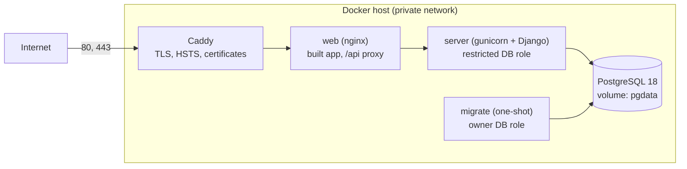

# Deploying Talaan

Talaan deploys to **one Docker host**: a small Linux VPS, a home server, a cloud VM. Nothing is
hosted yet (no server has been chosen), but everything below is tested in CI on every pull request
(`prod-smoke`), so when you pick a host it is a short checklist, not a project.



Only Caddy publishes ports. The database, Django and nginx are never reachable from outside. Caddy
gets and renews the HTTPS certificate for your domain by itself.

## What you need

- A Linux host with **1 vCPU and 2 GB RAM** or more, and Docker Engine with the Compose plugin (v2).
- A domain with an `A` (and optionally `AAAA`) record pointing at the host.
- Ports **80 and 443** (TCP, and UDP for 443) open to the internet, for certificates and traffic.
- Nothing else: no Node, Python or Postgres on the host.

## First deploy

```bash
sudo mkdir -p /opt/talaan && sudo chown "$USER" /opt/talaan
git clone https://github.com/bienthehuman/talaan.git /opt/talaan
cd /opt/talaan
git checkout v0.1.0                      # the release you want

cp .env.prod.example .env.prod && chmod 600 .env.prod
$EDITOR .env.prod                        # set TALAAN_DOMAIN and the four secrets (see below)

bash scripts/deploy.sh v0.1.0            # pulls images, migrates, starts, runs smoke checks
```

Generate each secret with `python3 -c "import secrets; print(secrets.token_urlsafe(48))"`. The stack
refuses to start if any secret is missing, and the server refuses a `DJANGO_SECRET_KEY` shorter than
32 characters.

If the release's images are not public (see [Images](#images)) and you would rather build on the
host, use `DEPLOY_BUILD=1 bash scripts/deploy.sh v0.1.0`. That needs the git checkout and more RAM.

Then create the first admin. Superusers count as admins; workers are added in `/admin/` and put in
the `worker` group.

```bash
docker compose --env-file .env.prod -f docker-compose.prod.yml exec server \
  python manage.py createsuperuser
```

`deploy.sh` ends with the smoke checks (`scripts/smoke.sh`): health and database, HTTPS headers,
CSP, caching rules, no debug pages, docs, admin and static files. Run them any time:

```bash
bash scripts/smoke.sh https://talaan.example.com
SMOKE_USER=admin SMOKE_PASSWORD=... bash scripts/smoke.sh https://talaan.example.com   # also signs in
```

## Updating and rolling back

Releases are git tags: `v0.2.0`. Pushing a tag on a commit that passed CI publishes the images and a
GitHub release (the `Release` workflow). To update the host:

```bash
cd /opt/talaan && git fetch --tags && git checkout v0.2.0 && bash scripts/deploy.sh v0.2.0
```

`deploy.sh` takes a database backup first, applies migrations as the owner role, starts the new
containers and runs the smoke checks. **Roll back** by deploying the previous tag the same way.

> Rolling back the code does not undo migrations. If a release changed the schema and you need the
> old data shape, restore the pre-deploy backup (below) after rolling back.

### Automatic deploy on tag

Off until you configure it, so tagging a milestone is always safe. In the repository settings:

| Where | Name | Value |
|---|---|---|
| Variables | `DEPLOY_ENABLED` | `true` |
| Variables | `DEPLOY_PATH` | checkout path on the host (default `/opt/talaan`) |
| Secrets (environment `production`) | `DEPLOY_HOST`, `DEPLOY_USER` | the host and an unprivileged user in the `docker` group |
| Secrets (environment `production`) | `DEPLOY_SSH_KEY` | a private key dedicated to deploys; put its public half in the user's `authorized_keys` |
| Secrets (environment `production`) | `DEPLOY_KNOWN_HOSTS` | output of `ssh-keyscan -t ed25519 <host>`, so the host key is pinned |

Add a required reviewer to the `production` environment if you want to approve each deploy. The
workflow can also be run by hand with a version, to redeploy or roll back without rebuilding.

## Images

The Release workflow pushes `ghcr.io/bienthehuman/talaan-server` and `talaan-web` tagged with the
release and `latest`. GitHub creates those packages private, so after the **first** release either
make them public (package page, Package settings, Change visibility) or log the host in once:

```bash
echo "$GHCR_TOKEN" | docker login ghcr.io -u <github user> --password-stdin   # token with read:packages
```

## Backups

```bash
bash scripts/backup.sh                       # backups/talaan-<UTC timestamp>.dump, keeps the newest 14
bash scripts/restore.sh latest               # DESTRUCTIVE: replaces the data (asks you to confirm)
bash scripts/restore.sh backups/talaan-20261117T031500Z.dump
```

`restore.sh` stops the app while it restores, keeps the restricted app role working (tested in CI),
and starts everything again. Run backups on a schedule and **copy them off the host**, because a
backup on the same disk does not survive losing the disk:

```cron
0 3 * * *  cd /opt/talaan && bash scripts/backup.sh >> /var/log/talaan-backup.log 2>&1
30 3 * * * rsync -a /opt/talaan/backups/ backup-host:/srv/backups/talaan/
```

## Running it

```bash
alias tc='docker compose --env-file /opt/talaan/.env.prod -f /opt/talaan/docker-compose.prod.yml'
tc ps                       # status and health
tc logs -f server           # application logs (also: web, caddy, db)
tc exec server python manage.py shell
```

- **Rotating `DJANGO_SECRET_KEY`** signs everyone out (their tokens stop verifying). Rotate it after
  any suspected leak.
- **Changing database passwords** after the first start needs `ALTER ROLE` in Postgres as well as a
  new `.env.prod`; the init script only runs on an empty volume.
- **Postgres major upgrades** are manual: back up, change the image tag, restore into a fresh volume.

## What is deliberately not here yet

- **No hosted demo** and no seeded demo logins. `seed_demo` only runs with debug on. A public demo
  with a nightly reset is in the backlog (`docs/BUILD_PLAN.md`).
- **No monitoring or alerting.** Use `tc ps`, the logs and an external uptime check on
  `/api/health/`. Metrics arrive with the operability work in v1.
- **Single host, single database.** No replicas or failover.
- **Fault injection is unavailable.** It needs debug on, and production runs with debug off; the
  server will not start with both `FAULT_INJECTION` and debug off.

## Troubleshooting

| Symptom | Likely cause |
|---|---|
| `required variable ... is missing a value` | A secret is empty in `.env.prod`. |
| `DJANGO_SECRET_KEY must be at least 32 characters` | Generate a longer key. |
| `server` unhealthy | `tc logs server`. Usually a database password that does not match the volume (the init script ran with different values earlier). |
| Browser says the certificate is invalid | DNS does not point at the host yet, or port 80/443 is blocked, so Caddy cannot get a certificate. `tc logs caddy`. |
| Admin login says "CSRF verification failed" | The domain in `.env.prod` differs from the one in the browser. |
| Everyone gets "too many attempts" at login | The proxy count is wrong, so all users share one address. The stack sets `NUM_PROXIES=2` (Caddy, nginx); do not add another proxy in front without raising it. |
| `pull access denied` | The images are private. See [Images](#images). |
