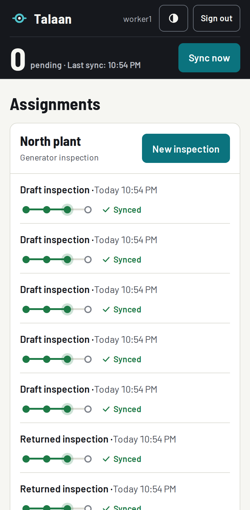
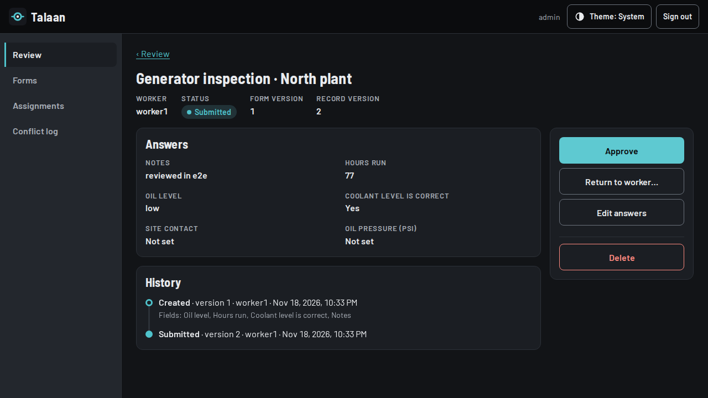
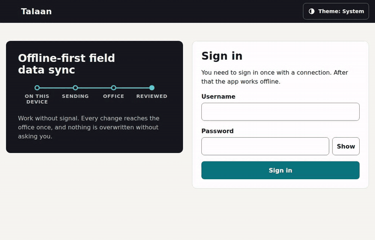

# Talaan

Offline-first field data sync. Field workers fill in inspection forms with no network, and every change
reaches the server **exactly once, with no silent overwrites, even when the network fails mid-sync**.

[](https://github.com/bienthehuman/talaan/actions/workflows/ci.yml)
[](https://github.com/bienthehuman/talaan/releases)
[](LICENSE)
[](https://codespaces.new/bienthehuman/talaan?quickstart=1)

An admin publishes a form and assigns it to a worker. The worker fills it in on a phone with no signal,
reloads, loses the connection again, and finally syncs. The admin reviews and approves it. Two phones that
edit the same field offline get a conflict screen instead of one of them quietly winning.

## See it

Both clips are real runs of the app (`bash scripts/demo.sh` records them), not mock-ups.

<p>
  
  
</p>

**Work offline, reload, reconnect while the server drops its first answer: one record, no duplicate.**



**Two phones change the same field offline: a conflict, nothing overwritten, then a decision.**


## Try it

The quickest way is Codespaces: click the badge above and wait a few minutes. It builds the stack, seeds
the demo data and opens the app on forwarded port 8080.

Or locally (Docker and Docker Compose):

```bash
cp .env.example .env
docker compose up -d --build --wait
docker compose exec server python manage.py seed_demo
# app: http://127.0.0.1:8080     API docs: http://127.0.0.1:8080/api/docs/
```

| Login | Password | What it is |
|---|---|---|
| `worker1`, `worker2` | `demo-password-1` | Field workers. Each has one assignment. |
| `admin` | `demo-password-1` | Review queue, forms, assignments and conflict log under `/manage`. |

## Try to break it

Do these in order; each one is something the app promises to survive.

1. **Go offline.** Sign in as `worker1`, then in the browser's developer tools turn on *Offline* (Network
   tab). Open *New inspection* and fill it in. The badge says "Saved on this device", never "Synced".
   Reload the page. It opens, and your answers and the pending count are still there.
2. **Reconnect and lose the answer.** The server can throw away its reply after it has already applied a
   change, which is what a phone sees when the signal dies at the wrong moment. From a terminal:
   `bash scripts/lost-response-demo.sh` pushes a record with `X-Fault: drop-after-commit` (you get a 503),
   sends the same mutation again, and shows the server answered from its ledger and holds **one** record.
   (Fault injection is on in Codespaces; locally start the stack with `FAULT_INJECTION=1`.)
3. **Make a conflict from two windows.** A second *window* of the same browser shares the same stored data,
   so use a **private/incognito window** (or another browser) as the second phone. Sign in as `worker1` in
   both, open the same inspection in both, and set both to *Offline*. Change *Notes* to different text in
   each, then bring window A back online and wait for "Synced". Now bring window B online: it stops and shows
   a decision screen with the starting value, yours and theirs. Nothing was overwritten. Choose one.
4. **Delete a record under a worker.** With a worker editing offline, delete the same record as `admin` in
   `/manage/review`. When the worker reconnects they are told it was deleted and keep their edits. Restore
   it as admin and *Sync now*: their edits are sent again.
5. **Edit something that was approved.** Approve a submitted record as admin, then edit it from a phone that
   has not synced yet. The server answers `locked`, the worker gets a plain message, and nothing retries.
6. **Look at it from the outside.** The sync panel (`/sync`, the "N pending" text in the header) shows what
   is waiting, how often it was tried and why it failed. `/manage/conflicts` is the admin's conflict log.

## Guarantees and non-guarantees

The five guarantees of [docs/protocol.md](docs/protocol.md) section 1, each with the tests that prove it.
Every scenario is an automated test, and the planted-bug scripts check that the tests can fail.

| Guarantee | Proved by |
|---|---|
| **1. A change is applied at most once**, however often it is sent | [idempotency](server/sync/tests/test_idempotency.py), [lost response](server/sync/tests/test_lost_response.py), [the same batch sent twice at once](server/sync/tests/test_concurrent_duplicate.py), [browser: dropped response](e2e/tests/02-lost-response.spec.ts) |
| **2. A change is applied whole or not at all** | [a refused submit leaves the record untouched](server/sync/tests/test_submit_delete.py), [locked records](server/sync/tests/test_locked.py), [browser: locked](e2e/tests/10-locked.spec.ts) |
| **3. No accepted change is silently overwritten** | [field-level conflicts](server/sync/tests/test_update.py), [20 concurrent updates](server/sync/tests/test_concurrent_updates.py), [merge](server/sync/tests/test_merge.py), browser: [merge](e2e/tests/04-merge.spec.ts), [conflict](e2e/tests/05-conflict.spec.ts), [deleted remotely](e2e/tests/06-deleted-remotely.spec.ts) |
| **4. A pull never skips a change** | [concurrent writers and a puller](server/sync/tests/test_pull_gap.py), with the [write-up showing it fail without the lock](docs/writeups/pull-gap.md) |
| **5. Transient failures lose nothing** | [the sync engine](client/src/sync/engine.test.ts), [atomic local writes](client/src/db/submissions.test.ts), browser: [offline reload](e2e/tests/01-offline-reload.spec.ts), [token expiry](e2e/tests/09-token-expiry.spec.ts) |

Also covered: a client that is too old gets a 426 and keeps its data
([test](server/sync/tests/test_client_schema.py)); one write path for submissions, enforced by the
[runtime guard and the database](server/sync/tests/test_write_guard.py). The full table is in
[docs/failure-scenarios.md](docs/failure-scenarios.md).

**Not guaranteed**, on purpose:

- **Real-time delivery.** Changes arrive when the app is open and syncing (on start, on reconnect, shortly
  after an edit, every minute). Nothing syncs while the app is closed; there is no dependency on the
  Background Sync API ([ADR 0009](docs/adr/0009-no-background-sync-dependency.md)).
- **Order across records.** Changes to one record are applied in order; different records are independent.
- **Local data at rest.** It is not encrypted on the device. Signing out removes it
  ([ADR 0010](docs/adr/0010-token-storage-and-session-resume.md)).
- **Surviving browser storage eviction.** The app asks the browser to protect its data and says on the
  sync page whether it agreed, but a browser may still clear a site's data under pressure.
- **Seeing what a worker did locally.** A worker who discards their edits leaves no trace on the server, so
  the conflict log can say "no later change from that worker", not "resolved".
- **Scale beyond one Postgres and one write lock.** See the numbers below.

## How fast, and where it stops

The write path serialises on one advisory lock ([ADR 0005](docs/adr/0005-advisory-lock-for-server-seq.md)),
so there is a ceiling, and it was measured: about **120 accepted mutations per second on a laptop**, with
the lock held about 7.8 ms per mutation. 50 devices syncing every ~10 s use about 5% of that (push p95
40 ms); 50 devices syncing every second use about 73% (push p95 180 ms); adding gunicorn workers raises the
queue at the lock, not the throughput. Hardware, dataset, caveats and exact commands:
[docs/loadtest/results.md](docs/loadtest/results.md).

## What I would change at scale

- **Replace the advisory lock.** First shorten the work done under it and take it once per push batch;
  then use a safe-watermark pull cursor (the alternative in ADR 0005) so writers stop serialising.
- **Partition `applied_mutation`** by time, and archive old partitions. Retries only need recent rows; the
  ledger is the table that grows without bound.
- **Purge tombstones** with a retention policy, after every device that could still hold the record has
  synced (soft deletes never expire today, [ADR 0006](docs/adr/0006-soft-deletes-with-tombstones.md)).
- **Metrics from rollups**, not grouped queries over the ledger at each scrape; per-device pull lag in a
  time-series store.
- **Several app servers behind PgBouncer**, a connection pool in front of Postgres, and read replicas for pull.
- **Attachments** through a separate resumable upload channel, referenced from submissions by id.
- **Token revocation** (rotation with a grace period for a lost refresh response) and encryption of local
  data at rest.

## How it is built

Django + DRF + simplejwt + PostgreSQL on the server; React + TypeScript + Vite + Dexie + a Workbox service
worker on the client; pytest, Vitest and Playwright; Docker Compose and GitHub Actions.

- Every accepted change goes through one function, `sync.services.apply_mutation`: an idempotency ledger row
  first, then the advisory lock, then the rules, the version bump and a `server_seq`, in one transaction.
  Nothing else may write a submission, and the database enforces that too.
- The server owns every version number and sequence; client clocks are only for display.
- The client reads and writes IndexedDB only. A sync engine pushes the outbox and pulls changes, behind a
  Web Lock so only one tab syncs.
- Roles are data (groups) and permissions are a catalog in code; the admin API checks the catalog, not role
  names.

Start with [docs/ARCHITECTURE.md](docs/ARCHITECTURE.md), the [protocol](docs/protocol.md), the
[push/pull lost-response diagram](docs/diagrams/push-pull-lost-response.md) and the
[ADRs](docs/adr/README.md). [docs/README.md](docs/README.md) is the full index.

## Develop and test

```bash
docker compose up -d --build --wait         # the whole stack, app at http://127.0.0.1:8080
bash scripts/e2e.sh                         # fresh database + the full Playwright suite (and the demo, unrecorded)
```

Server on the host (tests run as the least-privilege database role):

```bash
docker compose up -d db
cd server && python -m venv .venv && . .venv/bin/activate
pip install -r requirements-dev.txt
bash scripts/migrate.sh                     # migrations run as the owner role
python manage.py seed_demo
python -m pytest                            # python -m pytest -m phase1 runs the sync scenarios
```

Client: `cd client && npm ci && npm run dev` (port 5173), `npm test`, `npm run build`.
[CLAUDE.md](CLAUDE.md) has the working notes: ports, roles, the planted-bug checks, test helpers and the
gotchas that cost time.

## Deploying

One Docker host, HTTPS included, tested on every pull request but not hosted anywhere yet. See
[DEPLOY.md](DEPLOY.md). Logs are JSON with request ids and `/metrics` is available inside the stack.

## License

[MIT](LICENSE)
