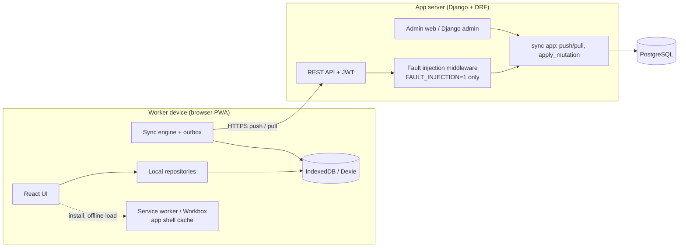

# Architecture

Status: accepted.

## 1. Components

One web client, one app server, one Postgres. No horizontal scaling in the PoC.

## 2. Server apps

| App | Owns |
|---|---|
| `forms` | `form`, `form_version` (immutable once published) |
| `assignments` | `assignment` |
| `submissions` | `submission`, `submission_event`, admin review actions |
| `sync` | push/pull views, `apply_mutation`/`_apply`, `applied_mutation`, `device`, fault injection |
| `accounts` | users, roles (groups), JWT endpoints, permission catalog |

**Single write path.** Every change to a submission, whether from a worker push or an admin action,
goes through `sync.services._apply`: advisory lock, version bump, `server_seq`, ledger row, event
row. No other code may write `submission`. A test greps the codebase for direct writes, and the DB
role limits what the app can do.

## 3. Client modules

| Path | Responsibility |
|---|---|
| `src/db/` | Dexie schema, versioned migrations, local repositories (atomic edit) |
| `src/sync/` | Engine: push, pull, backoff, error classes, Web Locks, auth pause/resume |
| `src/features/` | login, assignments, form filler, conflicts, admin review |
| `src/lib/` | API client (generated from OpenAPI), Zod schemas built from form JSON |

UI reads from IndexedDB only and never waits for the network. The engine is the only code that talks
to the sync endpoints.

## 4. Request path for a write (online)

1. UI calls `editSubmission` → one Dexie transaction writes the record and an outbox entry.
2. Engine (under the Web Lock) sends the oldest entry per record in a batch (max 50).
3. Server: per mutation, `transaction.atomic` → insert ledger row → advisory lock → lock row →
   rules → bump version, `server_seq` → event row → store result → commit.
4. Engine applies results to shadow and `serverVersion`, then pulls and applies changes.

The lost-response case is in [diagrams/push-pull-lost-response.md](diagrams/push-pull-lost-response.md).

## 5. Auth

`djangorestframework-simplejwt`: short-lived access token, refresh token. A 401 during sync refreshes the
token once and repeats the cycle; if that fails it pauses and asks for the password, leaving the outbox
untouched (ADR 0010). Offline use needs one prior login; local data is keyed
by `userId`. Roles are Django groups; permissions are a code catalog checked against `ROLES.md`.

## 6. Environments

| Env | How |
|---|---|
| Local | `docker compose up --build --wait` (db, migrate, server, web); seeded demo data |
| CI | GitHub Actions: the compose database (same roles as local) for pytest; Playwright against the compose stack; `prod-smoke` deploys the production stack |
| Production | `docker-compose.prod.yml`: Caddy (HTTPS) > nginx > gunicorn > Postgres on one Docker host; see `DEPLOY.md`. **Deployable, not hosted: no host chosen yet.** |

## 7. Production constraints from the skeleton

Least-privilege DB role (separate migration owner), security headers, rate limits on login and push,
secure cookies, no secrets in repo, axe a11y gate, `FAULT_INJECTION` refuses to load in production.

## 8. Known risks (documented, not solved)

- Local data is not encrypted at rest.
- Browsers may evict storage for sites that are not installed; Safari is most aggressive.
  Mitigation: `navigator.storage.persist()` and prompting to install.
- The advisory lock serializes writes (ADR 0005).
- Tombstones are never purged (ADR 0006).
