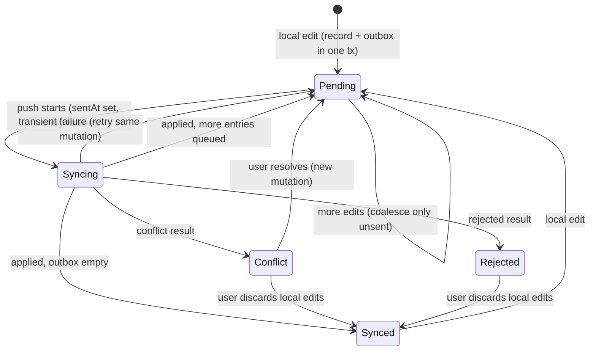

# Data model

Status: accepted. The server owns every version and sequence.

## 1. Server (PostgreSQL)

| Table | Columns | Notes |
|---|---|---|
| `form` | id, name | A form family, e.g. "Generator inspection" |
| `form_version` | id, form_id, number, schema JSONB, published_at | Immutable once published. Unique (form_id, number). |
| `assignment` | id, form_version_id, worker_id, site_name, due_date, cancelled_at | What a worker downloads |
| `submission` | id UUID (client-generated), assignment_id, form_version_id, data JSONB, status, version int, field_versions JSONB, server_seq bigint, deleted_at, updated_by, updated_at | `version` counts accepted changes; `field_versions[f]` = version that last changed f |
| `applied_mutation` | mutation_id UUID PK, device_id, user_id, result JSONB, created_at | Idempotency ledger, one row per mutation ever processed |
| `submission_event` | id, submission_id, version, kind, actor_id, mutation_id, detail JSONB, created_at | Append-only audit trail; feeds admin history and the v1 conflict log |
| `device` | id UUID, user_id, last_seen_at, app_version | Registered on first sync |

Submission status: `draft → submitted → approved`, plus `returned` (admin sends back; worker can
edit again). `approved` and `submitted` are locked for workers.

Indexes: `submission(server_seq)` (pull), `submission(assignment_id)`, `assignment(worker_id)`,
`submission_event(submission_id)`.

### Invariants enforced in the database

Each is enforced by the database whoever writes (code, admin, a shell) and has a test that runs as the
least-privilege application role.

- `submission.status` CHECK in (`draft`, `submitted`, `approved`, `returned`); `version >= 1`;
  `server_seq` unique, taken from sequence `submission_server_seq`.
- **One write path, enforced.** A trigger on `submission` rejects any change that is not exactly what
  the sync service does:
  - INSERT: `version` must be 1, and `form_version_id` must equal the assignment's.
  - UPDATE: `id`, `assignment_id` and `form_version_id` never change; `version` must be the old value
    plus exactly 1; `server_seq` must be strictly larger. A direct `.save()` that skips the version
    bump or the sequence fails.
  - DELETE: refused. Deletion is a tombstone (`deleted_at`).
- `form_version`: a trigger refuses any UPDATE or DELETE once `published_at` is set (publishing itself,
  `NULL` to a time on a draft, is the one allowed change). `(form_id, number)` is unique.
- `submission_event` is append-only: no UPDATE or DELETE privilege for the application role, and a
  trigger refusing both for every role.
- `applied_mutation`: a row is inserted with an empty `result`, which can then be set exactly once and
  must not be empty; no other column changes; no DELETE (privilege revoked and trigger).
- The app connects as a **least-privilege role** (no DDL, no superuser); migrations use a separate
  owner role. Triggers raise SQLSTATE `23514`, which Django surfaces as `IntegrityError`.

`version` starts at 1 on creation (the create is the first accepted change, so `field_versions` of the
initial fields are 1), and a `create` mutation carries `base_version: 0`.

## 2. Local stores (IndexedDB via Dexie)

| Store | Key fields | Notes |
|---|---|---|
| `submissions` | id, assignmentId, data, shadow, serverVersion, fieldVersions, status, syncState, deleted | `data` = what the user sees; `shadow` = last server-confirmed copy |
| `outbox` | seq (auto), mutationId, recordId, op, fields, baseVersion, sentAt, attempts, lastError | Sent in `seq` order |
| `assignments`, `formVersions` | id | Downloaded reference data |
| `meta` | key | `syncCursor`, `deviceId`, `userId`, `lastSyncAt` |

Keeping both `data` and `shadow` lets a pull update `shadow` without touching unsent edits, and lets
the conflict screen show mine, theirs and the starting value.

Local rules (slice 2.1, `client/src/db/`):

- **One IndexedDB database per user** (`talaan-user-<id>`), so data is keyed by `userId` by construction.
  The device id is a random UUID in localStorage, shared by every user of the browser.
- **A record and its outbox entry are written in one transaction**, so a killed tab leaves both or neither.
- **Coalescing.** An edit joins the record's newest outbox entry only if that entry is an unsent `create`
  or `update`. A sent entry is frozen (a retry resends it unchanged); the edit becomes a new entry. `submit`
  and `delete` are never merged. An `update` carries only the fields that changed (`null` clears).
- **`baseVersion`** of a new entry is the record's `serverVersion` (0 until the create is applied).
  The engine (slice 2.2) rebases the queued entries of a record after an `applied` result, but only when
  the applied version is exactly that entry's base + 1, i.e. nobody else wrote in between; otherwise the
  entry keeps its base so field conflict detection still sees the other writer.
- **Deleting a record the server has never seen** (no confirmed version, no sent entry) forgets the row and
  its entries instead of queueing a delete.
- **Engine rules** (slice 2.2, `client/src/sync/`, `client/src/db/apply.ts`): a batch holds the oldest
  queued entry of each record (at most 50, never two for one record) and skips records in `conflict` /
  `rejected`. Entries are stamped `sentAt` when first chosen and a retry resends them unchanged, so the
  same mutation ids reach the server until one is answered. `conflict` and `rejected` results keep the
  user's data and entries, store the server's copy as `shadow` (and the conflict report on the row), and
  stop that record syncing until the user decides. A pull never overwrites what the user sees: `data` is
  always the shadow with the still-queued entries laid on top. The cursor is saved in the same transaction
  as the page it covers.
- **Resolving conflicts** (slice 3.2, `client/src/db/resolve.ts`). A resolution is a new mutation: the
  conflicted entry keeps its place in the queue but gets a new mutation id (the old id's stored answer is the
  conflict) and `baseVersion` = the server's current version. `field_conflict`: for each clashing field the
  person keeps *mine* or takes *theirs*; fields given up are removed from every queued entry of the record,
  the rest go out unchanged, and an entry left empty is dropped. A decision with a missing choice is refused.
  `deleted_remotely`: discard (`discardLocalChanges`), or wait; when a pull brings the record back
  undeleted, the edits are re-queued under a new id on the **old** base, so edits others made before the
  delete still conflict. `edited_since_base` (this device deleted): keep the record (drop the delete) or
  delete anyway (a new delete on the current version). Update entries remember `before`, what each field
  held before the first unsent edit, for the screen's starting value.
- Edits are refused (`NotEditableError`) when the record is submitted or approved, deleted, or in
  `conflict` / `rejected` until the user resolves or discards.

## 3. Local sync state machine



UI labels: Pending = "Saved on this device", Synced = "Synced". They must never look alike.

## 4. Correction path for every write action

| Write action | Who | How it is corrected | Status |
|---|---|---|---|
| Create submission | worker | Soft delete while `draft`/`returned` | in scope |
| Edit field | worker | Edit again (new version); history in `submission_event` | in scope |
| Delete submission | worker | Admin `restore` (clears `deleted_at`, bumps version) | in scope |
| Submit | worker | Admin `return` (worker cannot withdraw) | in scope |
| Approve | admin | Admin `return` from `approved` with a reason (reopen) | in scope |
| Return | admin | Worker edits and resubmits | in scope |
| Admin delete | admin | Admin `restore` | in scope |
| Resolve conflict | worker | Discard local edits, or resolve again (new mutation) | in scope |
| Publish form version | admin | Versions are immutable. Publish a new version; re-assign. | in scope |
| Create assignment | admin | `cancel` (sets `cancelled_at`; existing submissions stay) | in scope |
| Reassign worker | admin | Not supported. Cancel and create. | backlog |
| Worker withdraw after submit | worker | Not supported. Ask admin to return. | backlog |
| Purge tombstones | system | Retention policy | backlog (ADR 0006) |

## 5. Form schema

`form_version.schema` is a deliberately small subset of JSON Schema (draft 2020-12), so the same document
drives the server (`jsonschema`) and the client (Zod) with identical behaviour. The rules live in
`server/forms/schema.py` and are checked when a version is published.

- One flat object: `"type": "object"`, `"additionalProperties": false` (unknown fields are rejected), at
  least one property. No nesting or arrays.
- Field names are stable identifiers, `^[a-z][a-z0-9_]{0,63}$`: they are the keys of submission `data` and
  of `field_versions`.
- Field `type` is one of `string`, `number`, `integer`, `boolean`. Allowed keys per field: `type`,
  `title`, `description`, `enum` (distinct non-empty strings, string fields only), `minLength`,
  `maxLength`, `minimum`, `maximum`.
- `required` lists field names that exist. **A draft may be incomplete**: validation of a `draft` or
  `returned` save ignores `required`; `submit` enforces every required field (protocol.md section 5).
- A published version is immutable. To change a form, publish a new version (ADR 0008).

### Sample form schema

The demo seed publishes this form. A test fails if this block and `server/forms/samples.py` differ.

```json
{
  "$schema": "https://json-schema.org/draft/2020-12/schema",
  "type": "object",
  "title": "Generator inspection",
  "properties": {
    "site_contact": {
      "type": "string",
      "title": "Site contact",
      "maxLength": 120
    },
    "oil_level": {
      "type": "string",
      "title": "Oil level",
      "enum": [
        "ok",
        "low",
        "empty"
      ]
    },
    "oil_pressure_psi": {
      "type": "number",
      "title": "Oil pressure (psi)",
      "minimum": 0,
      "maximum": 200
    },
    "coolant_ok": {
      "type": "boolean",
      "title": "Coolant level is correct"
    },
    "hours_run": {
      "type": "integer",
      "title": "Hours run",
      "minimum": 0
    },
    "notes": {
      "type": "string",
      "title": "Notes",
      "maxLength": 2000
    }
  },
  "required": [
    "oil_level",
    "coolant_ok",
    "hours_run"
  ],
  "additionalProperties": false
}
```
