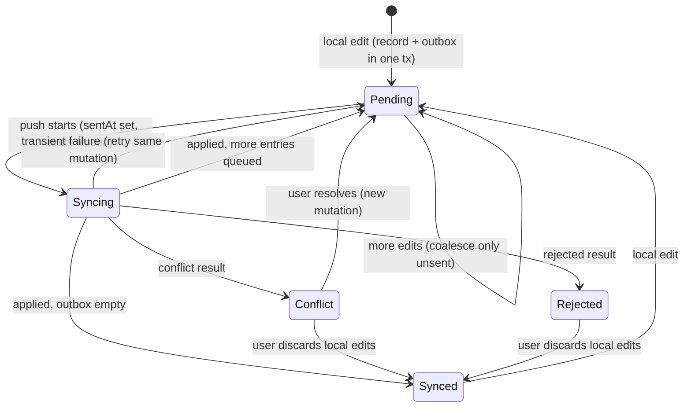

# Data model

Status: accepted. The server owns every version and sequence.

## 1. Server (PostgreSQL)

| Table | Columns | Notes |
|---|---|---|
| `form` | id, name | A form family, e.g. "Generator inspection" |
| `form_version` | id, form_id, number, schema JSONB, published_at | Immutable once published. Unique (form_id, number). |
| `assignment` | id, form_version_id, worker_id, site_name, due_date, cancelled_at | What a worker downloads |
| `submission` | id UUID (client-generated), assignment_id, form_version_id, data JSONB, status, version int, field_versions JSONB, server_seq bigint, deleted_at, updated_by, updated_at | `version` counts accepted changes; `field_versions[f]` = version that last changed f |
| `applied_mutation` | mutation_id UUID PK, device_id, user_id, result JSONB, created_at | Idempotency ledger, one row per mutation ever processed |
| `submission_event` | id, submission_id, version, kind, actor_id, mutation_id, detail JSONB, created_at | Append-only audit trail; feeds admin history and the v1 conflict log |
| `device` | id UUID, user_id, last_seen_at, app_version | Registered on first sync |

Submission status: `draft → submitted → approved`, plus `returned` (admin sends back; worker can
edit again). `approved` and `submitted` are locked for workers.

Indexes: `submission(server_seq)` (pull), `submission(assignment_id)`, `assignment(worker_id)`,
`submission_event(submission_id)`.

### Invariants enforced in the database

- `submission.status` CHECK in (`draft`,`submitted`,`approved`,`returned`).
- `submission.version >= 1`; `server_seq` unique and from sequence `submission_server_seq`.
- Trigger: `form_version` rows with `published_at` set cannot be updated or deleted.
- Trigger: `applied_mutation` and `submission_event` reject UPDATE (except `result` set within the
  inserting transaction) and DELETE; the app DB role has no UPDATE/DELETE grant on `submission_event`.
- `submission.form_version_id` must equal its assignment's `form_version_id` (checked on create).
- App connects as a **least-privilege role** (no DDL, no superuser); migrations use a separate owner role.

## 2. Local stores (IndexedDB via Dexie)

| Store | Key fields | Notes |
|---|---|---|
| `submissions` | id, assignmentId, data, shadow, serverVersion, fieldVersions, status, syncState, deleted | `data` = what the user sees; `shadow` = last server-confirmed copy |
| `outbox` | seq (auto), mutationId, recordId, op, fields, baseVersion, sentAt, attempts, lastError | Sent in `seq` order |
| `assignments`, `formVersions` | id | Downloaded reference data |
| `meta` | key | `syncCursor`, `deviceId`, `userId`, `lastSyncAt` |

Keeping both `data` and `shadow` lets a pull update `shadow` without touching unsent edits, and lets
the conflict screen show mine, theirs and the starting value. All local data is keyed by `userId`.

## 3. Local sync state machine

UI labels: Pending = "Saved on this device", Synced = "Synced". They must never look alike.

## 4. Correction path for every write action

| Write action | Who | How it is corrected | Status |
|---|---|---|---|
| Create submission | worker | Soft delete while `draft`/`returned` | in scope |
| Edit field | worker | Edit again (new version); history in `submission_event` | in scope |
| Delete submission | worker | Admin `restore` (clears `deleted_at`, bumps version) | in scope |
| Submit | worker | Admin `return` (worker cannot withdraw) | in scope |
| Approve | admin | Admin `return` from `approved` with a reason (reopen) | in scope |
| Return | admin | Worker edits and resubmits | in scope |
| Admin delete | admin | Admin `restore` | in scope |
| Resolve conflict | worker | Discard local edits, or resolve again (new mutation) | in scope |
| Publish form version | admin | Versions are immutable. Publish a new version; re-assign. | in scope |
| Create assignment | admin | `cancel` (sets `cancelled_at`; existing submissions stay) | in scope |
| Reassign worker | admin | Not supported. Cancel and create. | backlog |
| Worker withdraw after submit | worker | Not supported. Ask admin to return. | backlog |
| Purge tombstones | system | Retention policy | backlog (ADR 0006) |

## 5. Form schema

`form_version.schema` is JSON Schema (server) and drives Zod on the client. Each field has a type,
`required`, and optional constraints. One schema, both sides. Validation of drafts ignores
`required`; `submit` enforces it.
